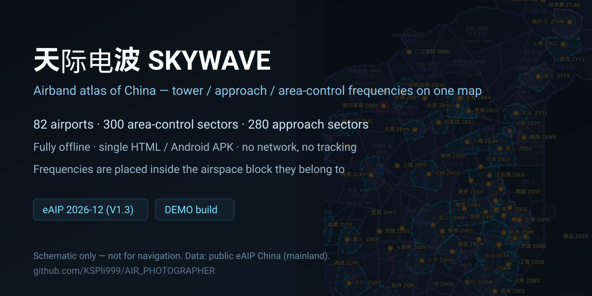
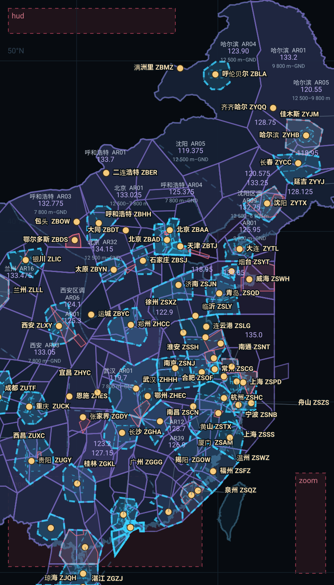
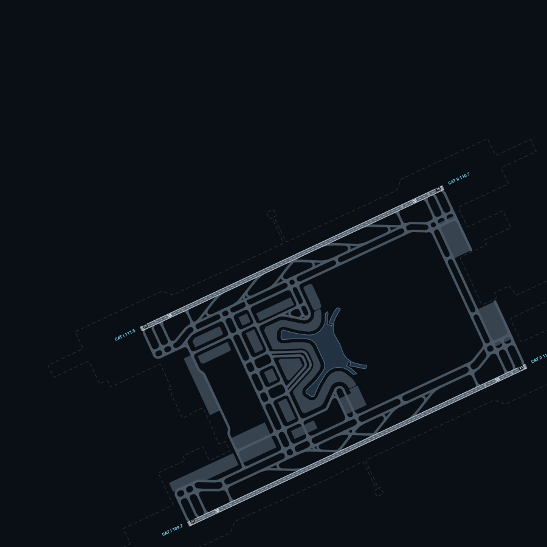
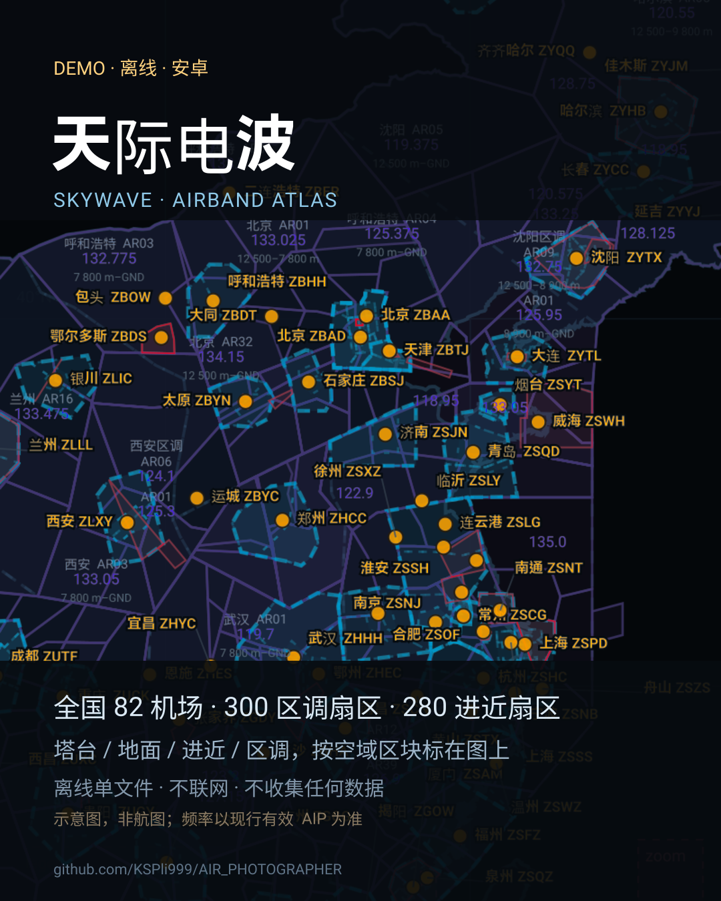

<p align="center"></p>

<h1 align="center">天际电波 · SKYWAVE</h1>

<p align="center">
   
   
</p>

<p align="center">
  <b>把全国空管频率，按它所属的空域画回地图上。</b><br>
  塔台 / 地面 / 放行 / 机坪 / 通播 / 进近 / 区调 —— 82 个机场、300 个区调扇区、280 个进近扇区，离线可用。<br>
  <sub>Tower / approach / area-control frequencies of China, placed inside the airspace blocks they belong to. Fully offline.</sub>
</p>

<p align="center">
  <a href="https://github.com/KSPli999/AIR_PHOTOGRAPHER/raw/main/apk/skywave-demo-v36.apk"><b>⬇️ 下载 DEMO APK（安卓直装）</b></a>
  &nbsp;·&nbsp;
  <a href="https://htmlpreview.github.io/?https://raw.githubusercontent.com/KSPli999/AIR_PHOTOGRAPHER/main/docs/index.html"><b>▶️ 在线试玩（免安装）</b></a>
</p>

<p align="center">
  <a href="https://github.com/KSPli999/AIR_PHOTOGRAPHER"></a>
</p>

> **如果这个项目帮你少翻了 200 页 AIP，给个 ⭐ 吧** —— 星标是它继续更新下一个 eAIP 周期的唯一动力。
> If SKYWAVE saved you a few hours of digging through AIP tables, a star helps keep it updated every cycle.

| 一张图能看到的 | |
|---|---|
| 全国视角 | 机场点 + 「北京 ZBAA」，不画缩小图，一眼看清分布 |
| 区域视角 | 频率按区块标注，同几何叠层扇区合并、按高度自上而下 |
| 机场视角 | 跑道 / 跑道号 / ILS / 塔台·地面·机坪频率（示意，非航图） |

<p align="center">
  
  
  
</p>

---

当前数据集：**全国 · 82 个机场 + 24 个管制单位 / 300 个区调扇区 + 280 个进近扇区**
数据周期：**EAIP 2026-12 (V1.3)**，2026-11-26 生效 / 2026-12-24 失效（2612 期）

| 项目 | 数量 |
|---|---|
| 机场（AD 2.18 通信设施） | 82 |
| 机场通信频率 | 748 条（塔台/地面/放行/机坪/通播/进近） |
| 区调扇区（ENR 2.1.3） | 300 个扇区 · 606 条主备频率 · 24 个管制单位 |
| 进近区（ENR 2.1.5） | 326 个（280 个带频率）· 557 条主备频率 |
| 情报区边界（ENR 2.1.1） | 9 个 FIR 轮廓，仅作底图 |
| 导航设施（AD 2.19） | 898 个（VOR/DME/ILS/NDB），其中 237 条跑道端 ILS 已对应到跑道号 |
| 机场道面 | 82 场 · 148 条跑道 · 15057 段滑行道 · 552 块机坪 · 197 栋航站楼（OSM ODbL） |
| 塔台管制区等 ATS 空域 | 46 个 |

## ⚠️ 声明与免责（DEMO 版）

- **合法使用**：本应用是离线资料查询工具，不含任何发射/接收/录音功能。任何收听、发射民航通信的行为须遵守《中华人民共和国无线电管理条例》《中华人民共和国民用航空法》等规定并取得许可，擅自收发、干扰民航通信属违法行为，后果由使用者自负。
- **地图仅供参考**：所有边界/扇区/跑道均为等距圆柱投影的示意图形，**不构成航图、导航、测绘或飞行依据**，不得用于真实飞行、导航、空域申请。真实飞行以现行有效 AIP/NAIP、航图与管制指令为准。
- **覆盖范围**：数据仅来自中国大陆公开 eAIP；**香港、澳门、台湾地区未在数据包内公布，故不包含**；军用、通航临时及未在 AIP 公布的频率同样不含。
- **非官方 · 时效**：与民航局、空管局及机场无隶属或授权关系；数据有生效/失效日期，过期请勿使用。
- **版本性质**：当前为 **DEMO 演示版**，功能与数据仍可能调整，不承诺完整性或准确性。
- **第三方**：道面 © OpenStreetMap contributors（ODbL）；跑道阈值参考 OurAirports（公有领域）。

## 发布链接

| 用途 | 链接 |
|---|---|
| 在线预览（第三方渲染 raw） | https://htmlpreview.github.io/?https://raw.githubusercontent.com/KSPli999/AIR_PHOTOGRAPHER/main/docs/index.html |
| 在线版（GitHub Pages，启用后生效） | https://kspli999.github.io/AIR_PHOTOGRAPHER/ |
| 仓库 | https://github.com/KSPli999/AIR_PHOTOGRAPHER |
| **DEMO APK 下载** | https://github.com/KSPli999/AIR_PHOTOGRAPHER/raw/main/apk/skywave-demo-v36.apk |
| DEMO APK（仓库内） | `apk/skywave-demo-v36.apk`（同内容：`apk/天际电波-DEMO.apk`） |
| DEMO APK（本机） | `/sdcard/Download/天际电波-DEMO.apk` |

启用 GitHub Pages：仓库 Settings → Pages → Source: **Deploy from a branch** → Branch: **main** / 目录 **/docs** → Save，约 1 分钟后 https://kspli999.github.io/AIR_PHOTOGRAPHER/ 生效。

## 产物 · 只做安卓

| 产物 | 位置 | 用途 |
|---|---|---|
| Android APP（DEMO） | `downloads/天际电波-DEMO.apk`（同内容：`天际电波.apk`） | 手机上装，完全离线；放大到机场显示跑道与对应频率 |
| 单文件网页 | `downloads/天际电波-单文件.html` | 双击即开，PC/手机都行，零依赖 |

APK 与 `docs/index.html`（GitHub Pages 在线版）用的是同一份界面和同一份数据。

## 怎么用

- **空域图**：默认全国视角。拖动平移、双指（或滚轮）/ `+ / −` 缩放；地图不会被拖出数据边界，放大后会自动出现扇区名与频率。
  频率**只写在所属区块里**：区调（紫色）、进近（蓝色）、塔台区（粉色）各用同色系标注，
  一块地方上下叠着多个高度层时合并成一个标题块、按高度自上而下排列（如「北京区调 / AR36 134.75 / 12 500–8 900 m / AR37 124.95 / 8 900 m–GND」），
  标注互相挤不下时会先省掉高度带、再省掉名称，至少保住主用频率，不会被挡掉。
  放大到机场尺度会自动叠加**机场道面**：跑道铺面（真实宽度）+ 滑行道 + 机坪 + 机场边界 + 航站楼轮廓，跑道端有条纹/中线/瞄准点/接地区标记；跑道号两端标注、ILS 标成 `CAT III 108.55`，右上角频率牌按跑道分列塔台（如 `124.3 18R/36L`）、地面、机坪、通播。
  点紫色区调扇区、蓝色进近区、粉色塔台区、黄色机场点，都会弹出该区域的频率表，点一行即复制。
  点机场弹层里的「放大到机场道面」可以直接跳到该场合适的缩放倍率，跑道朝向与频率一目了然。
  底图是按国界数据勾出的陆地轮廓，扇区边界在 AIP 原文写「National Boundaries」的地方会贴国境走。
- **频率总表**：搜索框输入机场名、ICAO、单位或频率（如「太原」「ZBAA」「118.25」）即时过滤；
  点机场那行会跳回地图并定位到该机场。
- **数据说明**：版本、覆盖范围、取用的 AIP 章节与免责说明。

## 目录

```
src/index.html           界面（唯一需要改 UI 的地方）
data/CN.json             全国数据集（一个文件）
build/gen-national.js    eAIP 原始 JSON -> data/CN.json
build/build.js           把 index.html + data 合成单文件 HTML（docs/downloads/apk 三处）
build/preview.js         生成 docs/preview.svg 预览图
build/gen-freq-check.js  频率标注自检：按真实投影出多张快照 SVG + 重叠/丢弃统计
build/serve.js           本地预览服务（127.0.0.1:3110）
apk/                     Android 工程（aapt + javac + d8 + apksigner，全在手机上构建）
build/gen-rwy.js          OurAirports 跑道阈值 -> data/RWY.json
build/gen-ground.js       OSM 道面抓取（Overpass，缓存到 ~/.cache/osm）
build/gen-ground-osmapi.js OSM 道面兜底抓取（OSM 主 API）
build/gen-ground-data.js  跑道线位抽稀 -> data/GROUND.json
docs/抓取流程.md          下个 AIRAC 周期怎么重新抓数据
docs/data-format.md      数据字段说明
```

## 重新构建

```bash
node build/gen-national.js   # 需先按 docs 抓好 ~/work/eaip 下的原始数据
node build/gen-rwy.js        # 下载 OurAirports 跑道坐标（首次联网，之后读缓存）
node build/gen-ground.js     # 抓 OSM 道面（可断点续跑；慢的话用 gen-ground-osmapi.js 兜底）
node build/gen-ground-data.js # 抽稀生成 data/GROUND.json
node build/build.js          # 生成单文件 HTML（docs/、downloads/、apk/assets/）
bash apk/build.sh            # 生成并签名 APK
cp apk/空域频率图.apk downloads/天际电波.apk
```

`build/gen-national.js` 默认读 `~/work/eaip`（`AIP.JSON`、`ad/<ICAO>.js`、
`apparea.json`、`ctaarea.json`），也可以传路径。APK 构建依赖 `$HOME/toolchain`
（aapt/javac/d8/apksigner/zipalign/keytool）与 `$HOME/android.jar`，
`$HOME/toolchain/lib` 需要进 `LD_LIBRARY_PATH`。

## 免责

供模拟飞行、学习与资料核对。真实飞行以现行有效 AIP/NAIP 与管制指令为准。
跑道线位来自 OurAirports（公有领域）的跑道阈值坐标，缺坐标的机场用 © OpenStreetMap contributors（ODbL）的跑道线兜底；未经逐场校对，仅作位置参考，不可作为滑行依据。
ILS 下滑台（GP）与指点标频率为机载接收频率，不可用于通话。

## License

MIT，见 [LICENSE](LICENSE)。数据来自中国民航 eAIP，版权归原发布方。
