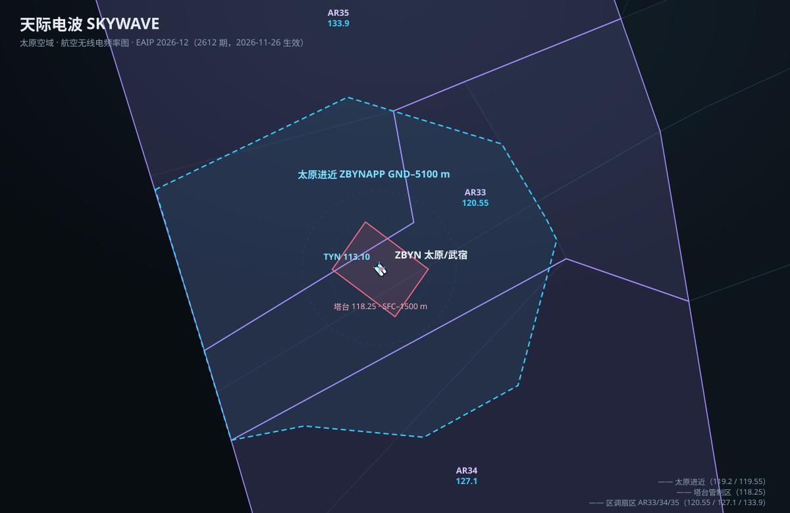

<p align="center"></p>

# 天际电波 · SKYWAVE

> 拍机人的航空波段图鉴：把 118–137 MHz 的塔台、进近、区调频率画到空域图上。按下快门前，先知道该听哪个波道。



当前数据集：**全国 · 82 个机场 + 24 个管制单位 / 300 个区调扇区 + 280 个进近扇区**
数据周期：**EAIP 2026-12 (V1.3)**，2026-11-26 生效 / 2026-12-24 失效（2612 期）

| 项目 | 数量 |
|---|---|
| 机场（AD 2.18 通信设施） | 82 |
| 机场通信频率 | 748 条（塔台/地面/放行/机坪/通播/进近） |
| 区调扇区（ENR 2.1.3） | 300 个扇区 · 606 条主备频率 · 24 个管制单位 |
| 进近区（ENR 2.1.5） | 326 个（280 个带频率）· 557 条主备频率 |
| 情报区边界（ENR 2.1.1） | 9 个 FIR 轮廓，仅作底图 |
| 导航设施（AD 2.19） | 898 个（VOR/DME/ILS/NDB） |
| 塔台管制区等 ATS 空域 | 46 个 |

## 产物 · 只做安卓

| 产物 | 位置 | 用途 |
|---|---|---|
| Android APP | `downloads/天际电波.apk` | 手机上装，完全离线；放大到机场显示 GND 风格道面示意 |
| 单文件网页 | `downloads/天际电波-单文件.html` | 双击即开，PC/手机都行，零依赖 |

APK 与 `docs/index.html`（GitHub Pages 在线版）用的是同一份界面和同一份数据。

## 怎么用

- **空域图**：默认全国视角。拖动平移、双指（或滚轮）/ `+ / −` 缩放；地图不会被拖出数据边界，放大后会自动出现扇区名与频率。
  放大到机场尺度会自动叠加道面示意：真实跑道阈值线位、滑行道、机坪、机场边界，跑道端标注跑道号与 ILS 频率，旁边附塔台/地面/机坪频率牌——类似 AIP 的 GND 图。
  点紫色区调扇区、蓝色进近区、粉色塔台区、黄色机场点，都会弹出该区域的频率表，点一行即复制。
  点机场弹层里的「放大到机场道面」可以直接跳到该场 50x 的道面视角，跑道朝向、滑行道与频率牌一目了然。
  底图是按国界数据勾出的陆地轮廓，扇区边界在 AIP 原文写「National Boundaries」的地方会贴国境走。
- **频率总表**：搜索框输入机场名、ICAO、单位或频率（如「太原」「ZBAA」「118.25」）即时过滤；
  点机场那行会跳回地图并定位到该机场。
- **数据说明**：版本、覆盖范围、取用的 AIP 章节与免责说明。

## 目录

```
src/index.html           界面（唯一需要改 UI 的地方）
data/CN.json             全国数据集（一个文件）
build/gen-national.js    eAIP 原始 JSON -> data/CN.json
build/build.js           把 index.html + data 合成单文件 HTML（docs/downloads/apk 三处）
build/preview.js         生成 docs/preview.svg 预览图
build/serve.js           本地预览服务（127.0.0.1:3110）
apk/                     Android 工程（aapt + javac + d8 + apksigner，全在手机上构建）
build/gen-rwy.js          OurAirports 跑道阈值 -> data/RWY.json
build/gen-ground.js       OSM 道面抓取（Overpass，缓存到 ~/.cache/osm）
build/gen-ground-osmapi.js OSM 道面兜底抓取（OSM 主 API）
build/gen-ground-data.js  道面数据抽稀 -> data/GROUND.json
docs/抓取流程.md          下个 AIRAC 周期怎么重新抓数据
docs/data-format.md      数据字段说明
```

## 重新构建

```bash
node build/gen-national.js   # 需先按 docs 抓好 ~/work/eaip 下的原始数据
node build/gen-rwy.js        # 下载 OurAirports 跑道坐标（首次联网，之后读缓存）
node build/gen-ground.js     # 抓 OSM 道面（可断点续跑；慢的话用 gen-ground-osmapi.js 兜底）
node build/gen-ground-data.js # 抽稀生成 data/GROUND.json
node build/build.js          # 生成单文件 HTML（docs/、downloads/、apk/assets/）
bash apk/build.sh            # 生成并签名 APK
cp apk/空域频率图.apk downloads/天际电波.apk
```

`build/gen-national.js` 默认读 `~/work/eaip`（`AIP.JSON`、`ad/<ICAO>.js`、
`apparea.json`、`ctaarea.json`），也可以传路径。APK 构建依赖 `$HOME/toolchain`
（aapt/javac/d8/apksigner/zipalign/keytool）与 `$HOME/android.jar`，
`$HOME/toolchain/lib` 需要进 `LD_LIBRARY_PATH`。

## 免责

供模拟飞行、学习与资料核对。真实飞行以现行有效 AIP/NAIP 与管制指令为准。
机场道面示意由 OurAirports（公有领域）的跑道阈值坐标与 © OpenStreetMap contributors（ODbL）的滑行道/机坪/边界数据绘制，未经逐场校对，仅作位置参考，不可作为滑行依据。
ILS 下滑台（GP）与指点标频率为机载接收频率，不可用于通话。

## License

MIT，见 [LICENSE](LICENSE)。数据来自中国民航 eAIP，版权归原发布方。
